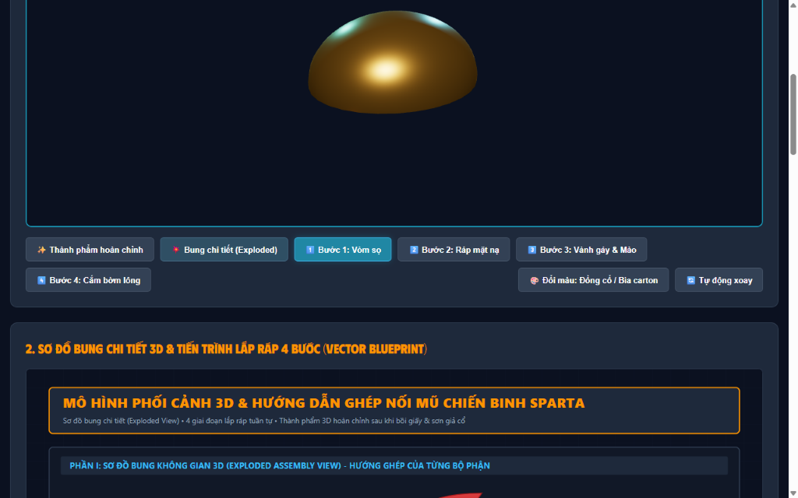

# 🛡️ MÔ HÌNH 3D & BẢN VẼ KỸ THUẬT MŨ CHIẾN BINH SPARTA (KING LEONIDAS 300)

Dự án thiết kế mô hình 3D tương tác, bản vẽ kỹ thuật chi tiết 2D (SVG) và bộ khuôn in A4 để tự làm mũ chiến binh Sparta (King Leonidas 300) bằng bìa carton, được hiệu chuẩn chính xác theo **nhân trắc học cỡ đầu người Việt Nam (vòng đầu 55 – 57 cm)**.

---

## 🌟 TÍNH NĂNG NỔI BẬT

1. **Trình mô phỏng 3D tương tác (Three.js / WebGL)**:
   - Xoay 360° tự do, phóng to / thu nhỏ chi tiết.
   - **Chế độ bung chi tiết (Exploded Assembly View)**: Tách rời các khối trong không gian 3D để quan sát hướng gắn kết.
   - **Xem 4 bước lắp ghép tuần tự**: Từng công đoạn từ vòm sọ, mặt nạ, vành gáy đến bờm lông.
   - **Chuyển đổi chất liệu**: Chuyển đổi giữa màu bìa carton mộc và màu vàng đồng cổ (antique bronze) bồi sơn hoàn thiện.
2. **Bản vẽ kỹ thuật 2D Vector (SVG)**:
   - Đầy đủ thông số kích thước (cm / mm), góc nghiêng sống mũi 110°, hốc mắt 18°, độ cong vành gáy.
   - Bảng nhân trắc học đối chiếu vòng đầu và khe co giãn (darts).
3. **Bộ rập in A4 (Printable Templates)**:
   - Sẵn sàng xuất in trên giấy A4 với tỷ lệ 1:1 để dán trực tiếp lên bìa carton và cắt theo đường viền.

---

## 📐 THÔNG SỐ KÍCH THƯỚC CHUẨN (CHO ĐẦU NGƯỜI VIỆT)

* **Vòng đầu danh định**: 55 – 57 cm (chu vi trong mũ thiết kế 58.5 – 59.0 cm, đã cộng thêm dung sai đệm 2.5 cm).
* **Đường kính lưỡng đỉnh (chiều rộng đầu)**: 15.0 – 15.5 cm.
* **Độ sâu trước – sau (chiều dài đầu)**: 18.0 – 18.5 cm.
* **Chiều cao vòm chóp sọ**: 14.5 cm (đáy cung 29.5 cm mỗi nửa).
* **Mặt nạ bảo vệ mặt**: Cao tổng thể 26.5 cm, sống mũi dài 12.5 cm, khoét mắt 6.5 × 2.8 cm nghiêng 18°.
* **Vành xòe che gáy**: Cung cong 29.0 cm, chiều rộng loe 4.5 cm.
* **Khung hộp mào cắm bờm**: Cung mào 34.5 cm, cao 6.0 cm, gồm 3 chốt định vị khoảng cách 3.5 × 4.0 cm.

---

## 🛠️ NGUYÊN VẬT LIỆU & DỤNG CỤ CẦN CHUẨN BỊ

* **Bìa carton sóng 3 lớp**: Độ dày 2.5 – 3.0 mm (chọn bìa đanh, cứng, không bị xẹp sóng).
* **Súng bắn keo nến nhiệt**: Keo gắn kết cấu chính.
* **Keo sữa PVA + Giấy báo cũ**: Dùng để bồi 3 – 4 lớp (papier-mâché) tạo bề mặt phẳng mịn, cứng như mũ giáp thật và che toàn bộ gân sóng carton.
* **Sợi chổi cước đỏ**: Cắt lấy chùm sợi dài 10 – 12 cm để làm bờm lông ngựa (plume).
* **Sơn xịt & màu cọ**:
  - Sơn lót đen mờ (Matte Black) phủ toàn bộ bề mặt.
  - Sơn acrylic vàng kim / đồng thau (Metallic Gold / Antique Bronze) quét kỹ thuật cọ khô (dry-brushing) tạo hiệu ứng kim loại cổ xưa.

---

## 🚀 HƯỚNG DẪN SỬ DỤNG

### Mở trình duyệt xem mô hình 3D & Bản vẽ:
Chỉ cần nhấp đúp để mở tệp:
👉 **`index.html`** hoặc **`ban_ve_kich_thuoc_mu_linh.html`** trên trình duyệt (Google Chrome, Microsoft Edge, Cốc Cốc, Firefox).

### Các tệp chính trong thư mục:
* `index.html` / `ban_ve_kich_thuoc_mu_linh.html`: Trang tổng hợp mô hình 3D WebGL tương tác + bản vẽ vector + hướng dẫn kỹ thuật.
* `ban_ve_ky_thuat_mu_linh_spartan.svg`: Bản vẽ kỹ thuật 2D chi tiết các mảnh rập kèm đường kích thước.
* `ban_ve_3d_lap_rap_spartan.svg`: Sơ đồ bung nổ không gian 3D và 4 giai đoạn ghép nối.
* `ban_in_A4/`: Thư mục chứa các trang rập in A4 chuẩn tỷ lệ.
* `generate_3d_guide.py`: Script Python tự động sinh tệp HTML & sơ đồ vector.
* `generate_blueprint.py`: Script Python tạo bản vẽ kỹ thuật 2D.

---

## 📜 GIẤY PHÉP

Dự án mã nguồn mở phục vụ mục đích học tập, chế tác thủ công (DIY Cosplay) và giáo dục nhân trắc học ứng dụng.
